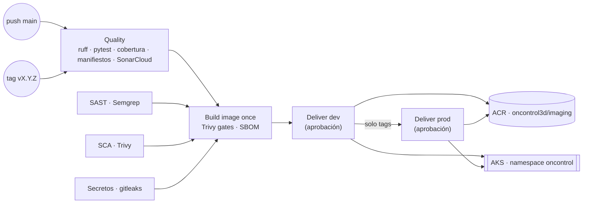

# Pipeline CI/CD — Imaging Service

Mismo diseño que el Clinical Service (ver `docs/pipeline.md` en `oncontrol3d-backend-clinical`, con el
diagrama completo y el flujo de secretos).



| Etapa | Corta si… |
|---|---|
| ruff + pytest (92 pruebas) + cobertura | Error de lint, prueba fallida |
| Manifiestos (`deploy/render.sh` + kubeconform) | Variable faltante o schema inválido |
| SAST / SCA / secretos | ERROR de Semgrep · CRITICAL o HIGH con parche · secreto en el árbol |
| Imagen | CRITICAL o HIGH con parche en la imagen |
| Deliver | Rollout o smoke test fallido → **rollback automático** |

- **Imágenes:** `sha-<commit>` en `main`; `X.Y.Z`, `X.Y` y `sha-…` en tags `vX.Y.Z`. Se despliegan **por digest**.
- **Sin identidad de Azure en el pod:** imaging no lee secretos de Key Vault (las credenciales de Orthanc son opcionales).
- **Pod:** no root, `readOnlyRootFilesystem`, sin capabilities, `/app/storage` en `emptyDir` (los volúmenes se regeneran desde Orthanc).
- **Gitflow:** los push a `develop` corren CI y escaneos; `main` y los tags corren el delivery completo.

## Release v1.0.0

```bash
git switch main && git pull --ff-only
git tag -a v1.0.0 -m "OnControl3D Imaging Service 1.0.0 - Tercer Avance"
git push origin v1.0.0
```

## Pendiente

`PUBLIC_BASE_URL` y `VOLVIEW_URL` apuntan a direcciones internas del cluster: VolView necesita URLs
públicas para descargar los volúmenes una vez que la plataforma se exponga con un ingress HTTPS.
